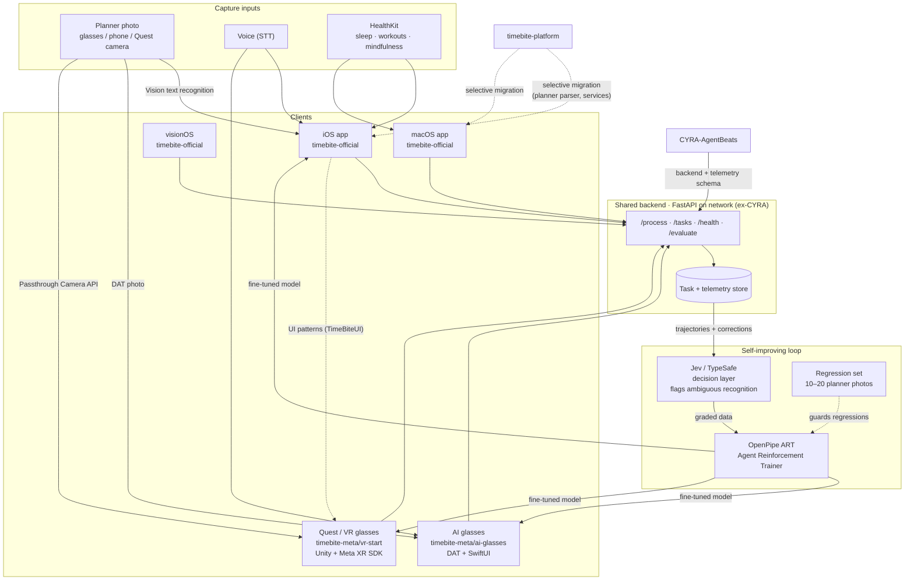

# TimeBite Meta Plan — System Design

How the repos, clients, backend, and self-improving loop fit together across the
App Store, AI hackathon, and VR Start tracks. Companion files: `timebite-build-plan.csv`
(staged plan by date, importable into Notion) and `codex-dogfood-prompt.md`.

## Repo map

| Repo | Role |
|---|---|
| `timebite-official` | Canonical production app: iOS, macOS, watchOS, visionOS. Swift packages (Core/UI/Data/Health/Sync). |
| `timebite-meta` *(new)* | Meta-platform entries. `ai-glasses/` = DAT + SwiftUI (AI hackathon). `vr-start/` = Unity + Meta XR SDK (VR Start). Both consume `timebite-official` packages/patterns and the shared backend. |
| `timebite-platform` | Experimental source repo. Planner parser and services migrate **selectively** into `timebite-official`; finance/admin/agent surfaces stay out. |
| `CYRA-AgentBeats` | Donor repo. FastAPI backend (`/process`, `/tasks`, `/health`) deploys to the network as the shared task API; its telemetry payload schema becomes the graded-trajectory format for the ART loop. iOS client is reference only — not merged. |

## Architecture

## Data flow (the loop that matters)

1. **Capture** — planner photo (glasses/phone/Quest), voice, or HealthKit enters a client.
2. **Structure** — on-device Vision recognition produces text; a model (Muse / Meta model, later the ART-tuned one) converts it to structured tasks; `POST /process`.
3. **Decide** — Jev/TypeSafe flags ambiguous recognition points; the user corrects them in the review UI.
4. **Grade** — every accept/correction is logged as telemetry: a graded trajectory.
5. **Improve** — the OpenPipe ART consumer turns graded trajectories into training data; the fine-tuned model ships back to clients.
6. **Guard** — the regression set runs after each training round.

## Process by stage

- **Stage 0 · Foundation (Sep 30 – Oct 3):** backend on network, SSO fix, `timebite-meta` repo created, Unity scaffold started in background.
- **Stage 1 · TestFlight sprint (Oct 4 – Oct 12):** iOS + macOS (activity-loop scope) to submission; App Review appointment Oct 13; watchOS deferred.
- **Stage 2 · AI hackathon (10 days, dates TBD):** DAT capture → Vision → model structuring → `/process`, telemetry on, demo submission.
- **Stage 3 · VR Start (Oct 13 – Nov 18, parallel):** Unity hands-first task list + ring, network backend, telemetry for the Agentic Interaction entry, submission by Nov 18.
- **Stage 4 · Data loop (Nov 18+):** TestFlight data accumulates → ART consumer built → regression set → the loop runs itself.

## Key constraints

- The two Meta entries share **design and backend, not code**: `ai-glasses/` shares SwiftUI with iOS via DAT; `vr-start/` is a Unity rebuild.
- `localhost` backends do not work from headset or glasses — the API must be network-hosted from Stage 0.
- HealthKit is iOS-side; macOS runs standalone on local data (no iPhone relay).
- Nothing from `CYRA-AgentBeats` merges into `timebite-official`; the backend deploys, the client is reference.
